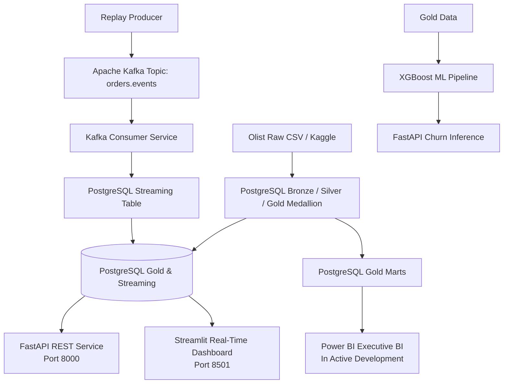

# Logistack: End-to-End E-Commerce Data Engineering, Streaming & Analytics Platform

[](https://www.python.org/)
[](https://www.postgresql.org/)
[](https://kafka.apache.org/)
[](https://fastapi.tiangolo.com/)
[](https://streamlit.io/)
[](https://www.docker.com/)
[](https://scikit-learn.org/)
[](https://xgboost.ai/)
[](https://powerbi.microsoft.com/)
[](https://git-scm.com/)

Logistack is an end-to-end analytics platform built around Brazilian marketplace data. It combines a historical PostgreSQL medallion warehouse with a replayable Kafka event stream, ML workflows, a REST API, and an interactive operations dashboard.

> **Data and streaming note:** This project uses the historical Olist Brazilian E-Commerce Public Dataset (2016–2018), containing approximately 100,000 orders and related customer, payment, product, review, seller, and location records. Kafka events are generated by replaying historical orders; this is a real-time *simulation*, not live marketplace traffic.

## Architecture



## What the platform includes

### Data engineering and analytics

- Historical CSV ingestion and Bronze, Silver, and Gold medallion transformations in PostgreSQL.
- Analytical star/snowflake style facts, dimensions, and marts for order, sales, customer, product, and delivery analysis.
- Batch analytics are complemented by a Kafka-based order replay stream for near-real-time operational monitoring.

### Event streaming

- A replay producer publishes historical orders to the `orders.events` Kafka topic.
- The consumer validates event payloads and uses deterministic event IDs with PostgreSQL `ON CONFLICT ... DO NOTHING` for idempotent writes.
- Invalid messages are skipped and counted. The current implementation does not publish invalid events to a DLQ; do not interpret “0 DLQ” as a configured dead-letter queue.
- The streaming monitor surfaces incoming order activity and consumer statistics.

### Machine learning

- K-Means based RFM customer segmentation, with business labels such as **Champions**, **Loyal**, **At Risk**, and **Hibernating**.
- An XGBoost churn inference pipeline served by FastAPI. Production training pools three 180-day snapshots (2017-10-01, 2017-12-15, and 2018-03-04). A single snapshot provided too few minority-class examples and could not represent seasonal variation; temporal pooling increased the cohort from 1,753 to 3,678 rows.
- `GroupShuffleSplit` partitions by `customer_unique_id`, so a customer's records cannot appear in both train and test (Customer Overlap: **0**). The scaler is fitted on training rows only.
- Model experiments compare Logistic Regression, Random Forest, LightGBM, and XGBoost. The sliding-window XGBoost model is selected for production. See [`experiments/benchmark_results.md`](experiments/benchmark_results.md) and [`experiments/`](experiments/) for experiment scripts and details.

| Tek Snapshot vs. Sliding Window | Tek Snapshot | Sliding Window |
| --- | ---: | ---: |
| Toplam veri hacmi | 1,753 | 3,678 |
| Test seti boyutu | 351 | 723 |
| Test azınlık sınıfı (TN + FP) | 14 | 39 |
| Doğru yakalanan TN | 7 (%50.0) | 20 (%51.3) |
| Accuracy | %80.06 | %82.30 |
| F1-Score | 0.8867 | 0.8998 |
| ROC-AUC | 0.7525 | 0.7398 |

Sliding Window ROC-AUC is slightly lower on the expanded test pool, which provides a more realistic and robust generalization evaluation across multiple temporal cohorts.

| Model | ROC-AUC | PR-AUC | F1 | Accuracy | Status |
| --- | ---: | ---: | ---: | ---: | --- |
| **XGBoost (Sliding Window)** | **0.7398** | **0.9781** | 0.8998 | 0.8230 | **Sliding Window (Production)** |
| Logistic Regression (Baseline) | 0.7033 | — | — | 0.6980 | Baseline |
| Random Forest (class_weight=balanced) | 0.6872 | 0.9785 | 0.9752 | 0.9516 | Compared |
| LightGBM (class_weight=balanced) | 0.6617 | 0.9779 | 0.9613 | 0.9259 | Compared |

### Backend and dashboard

- FastAPI with Pydantic request/response validation and interactive Swagger UI at `/docs`.
- API routes include KPI metrics (`/api/v1/metrics/kpis`), customer segments (`/api/v1/customers/segments`), streaming stats (`/api/v1/streaming/stats`), and churn inference (`/api/v1/predict/churn`).
- Streamlit provides filtered analytics pages and a live operations/streaming monitor.

### Power BI Executive BI — In Active Development

The executive dashboard is planned around AOV (average order value), revenue, order volume, and delivery delay rates. Power BI integration and the dashboard itself are in active development.

## Quickstart

### Prerequisites

- Docker
- Docker Compose (the `docker compose` plugin)

1. Clone the repository and enter its directory.
2. Create a local environment file from the template:

   ```bash
   cp .env.example .env
   ```

   On PowerShell, use `Copy-Item .env.example .env`.

3. Start the stack:

   ```bash
   docker compose up -d --build
   ```

The API, dashboard, PostgreSQL, Kafka, and consumer services are defined in `docker-compose.yml`. Load the Olist source CSV files into the expected local data path and run the repository ETL workflow to populate the warehouse before exploring analytics; dataset files are intentionally excluded from Git.

| Service | Address |
| --- | --- |
| Streamlit Dashboard | [http://localhost:8501](http://localhost:8501) |
| FastAPI Swagger UI | [http://localhost:8000/docs](http://localhost:8000/docs) |
| PostgreSQL | `localhost:5434` |
| Kafka broker | `localhost:9092` |

## API endpoints

| Capability | Endpoint |
| --- | --- |
| KPI metrics | `GET /api/v1/metrics/kpis` |
| Customer segments | `GET /api/v1/customers/segments` |
| Streaming statistics | `GET /api/v1/streaming/stats` |
| Churn inference | `POST /api/v1/predict/churn` |

Open Swagger UI at `/docs` for request schemas and interactive API exploration.

## Repository structure

```text
.
├── analytics/                 # Analytics and business logic
├── api/                       # FastAPI app, schemas, and routers
│   └── routers/               # Metrics, segments, streaming, predictions, health
├── dashboard/                 # Streamlit app, pages, styles, database access
│   └── pages/                  # Overview, customer/delivery, streaming monitor
├── data/                      # Local source data (raw data is gitignored)
├── database/                  # Database schema and SQL assets
├── etl/                       # Batch extraction, transformations, and loading
├── experiments/               # Churn model training and benchmark results
├── ingestion/                 # Kafka replay producer and consumer
├── models/                    # Churn model training and inference artifact
├── docker-compose.yml         # Local multi-service stack
├── Dockerfile                 # Shared Python service image
├── requirements.txt           # Python dependencies
└── .gitignore                 # Local secrets, data, caches, dumps, and temp files
```

## Data source

Olist Brazilian E-Commerce Public Dataset on [Kaggle](https://www.kaggle.com/datasets/olistbr/brazilian-ecommerce). The dataset covers orders from 2016–2018 and includes linked customer, payment, product, review, seller, and geolocation data. The platform uses historical data for batch analytics and replays selected historical orders for streaming demonstrations.

## License and dataset terms

Add the project’s chosen software license before redistributing the code. The Olist dataset remains subject to its Kaggle dataset terms and should be obtained from the original source.
